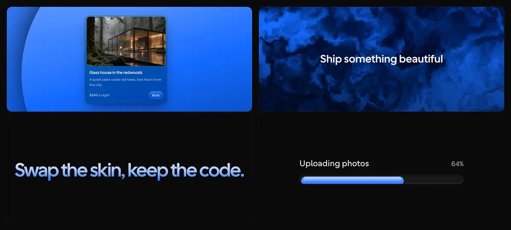

<a href="https://skinsui.dev"></a>

<h1 align="center">Skins UI</h1>

<p align="center">
  React components, each drawn in many skins.<br>
  Every skin of a component takes the same props, so changing its look is a one-line edit.
</p>

<p align="center">
  <a href="https://github.com/ksparth12/skins-ui/actions/workflows/ci.yml"></a>
  <a href="LICENSE"></a>
  <a href="https://github.com/ksparth12/skins-ui/stargazers"></a>
  
  
  
</p>

<p align="center">
  <a href="https://skinsui.dev"><b>Browse every skin</b></a> ·
  <a href="https://skinsui.dev/docs/installation">Get started</a> ·
  <a href="https://skinsui.dev/docs/theming">Theming</a> ·
  <a href="CONTRIBUTING.md">Contributing</a>
</p>

## One colour, every skin

Pick a colour and every skin follows it, in light and dark, with readable text guaranteed. The same four skins, through seven colours:



## Why Skins UI

- **One API, many looks.** Glass, brutalist, clay, chrome, pixel and more. Swap `button-glass` for `button-brutal` and nothing else in your code changes.
- **The code is yours.** A skin is one file copied into your project. Read it, change it, keep it.
- **Accessible underneath.** Interactive skins are built on Base UI, so keyboard, focus and screen readers work the same in every skin.

## A few of the skins

<table>
  <tr>
    <td width="50%"><a href="https://skinsui.dev/components/background/chrome"></a></td>
    <td width="50%"><a href="https://skinsui.dev/components/frame/polaroid"></a></td>
  </tr>
  <tr>
    <td width="50%"><a href="https://skinsui.dev/components/modal/brutal"></a></td>
    <td width="50%"><a href="https://skinsui.dev/components/counter/odometer"></a></td>
  </tr>
  <tr>
    <td width="50%"><a href="https://skinsui.dev/components/text/chrome"></a></td>
    <td width="50%"><a href="https://skinsui.dev/components/toast/clay"></a></td>
  </tr>
</table>

Every skin is live at [skinsui.dev](https://skinsui.dev), with controls for each prop and its full code.

## Get started

You need a React 19 project with Tailwind CSS v4. Next.js, Vite, React Router and other frameworks all work.

Add a skin with the shadcn CLI:

```bash
npx shadcn@latest add https://skinsui.dev/r/button-glass.json
```

The skin is saved to `components/skins` and its packages are installed. The first skin you add also writes the design tokens into your main CSS file.

```tsx
import { Button } from "@/components/skins/button-glass";

export function Save() {
  return <Button>Save changes</Button>;
}
```

To change the look, add another skin and change the import. To set your colour, pick one in [Theming](https://skinsui.dev/docs/theming) and copy its CSS.

Prefer to copy files by hand? [Installation](https://skinsui.dev/docs/installation) covers that too.

## Components

13 components, 78 skins, and growing.

| Component | Skins |
|---|---|
| Background | Liquid chrome, Dither, Dusk, Plasma, Silk |
| Button | Brutal, Chrome, Clay, Depth, Edge, Flat, Glass, Neumorph, Outline, Pixel, Soft 3D, Sticker |
| Card | Brutal, Clay, Depth, Double border, Edge, Flat, Glass, Neumorph, Pixel |
| Counter | Chrome, Flip, Odometer, Pixel, Roll |
| Image frame | Brutal, Gallery mat, Glass, Neumorph, Polaroid |
| Loader | Clay, Liquid, Orbit, Pixel, Ring |
| Modal | Brutal, Flat, Glass, Pixel |
| Navbar | Brutal, Edge, Flat, Glass |
| Progress | Chrome, Depth, Flat, Liquid, Neumorph, Pixel |
| Segmented control | Brutal, Chrome, Flat, Glass, Neumorph, Pixel |
| Switch | Brutal, Chrome, Clay, Flat, Glass, Neumorph, Pixel |
| Text | Chrome, Depth, Letterpress, Pixel, Sheen |
| Toast | Brutal, Clay, Flat, Glass, Pixel |

## Contributing

New skins are welcome. [CONTRIBUTING.md](CONTRIBUTING.md) explains how a skin is put together and how to send one in, and [DESIGN.md](DESIGN.md) holds the rules every skin follows.

## Develop

You need Node 26 and pnpm.

```bash
pnpm install
pnpm dev          # the site at http://127.0.0.1:7000
pnpm test         # colour system tests
pnpm check        # repository rules
pnpm typecheck
pnpm build
```

| Path | What it holds |
|---|---|
| `registry` | Every skin, one folder each, and each component's shared API |
| `apps/site` | The site at skinsui.dev |
| `packages/hue` | Turns one colour into a full colour system with guaranteed contrast |
| `packages/tokens` | The design tokens every skin reads, and the install registry |
| `packages/checks` | The rules every change must pass |

## License

[MIT](LICENSE). Fonts and marks included with the site keep their own licences, listed in [THIRD_PARTY_NOTICES.md](THIRD_PARTY_NOTICES.md).
